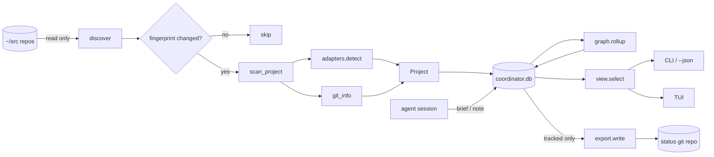

# Architecture

[← Back to Project README](../README.md) · [Docs index](README.md)

## Contents
- [Layers](#layers)
- [Modules](#modules)
- [Data flow](#data-flow)
- [Data model](#data-model)
- [Adapters](#adapters)
- [Incremental scan](#incremental-scan)
- [Dependency graph and rollup](#dependency-graph-and-rollup)
- [Loop breakers](#loop-breakers)
- [Storage layout](#storage-layout)
- [Extending](#extending)

## Layers

```
 surfaces     cli.py (argparse, --json)          tui.py (curses)
                      \                            /
 shared view            view.py  select() row() detail()
                                   |
 orchestration          engine.py  scan()  refresh()  lock()
                       /        |            \
 domain       scan.py       graph.py        export.py
          discover/scan_project  SCC+rollup   status git repo
                 |
            adapters.py  (one function per planning framework)
                 |
 persistence      store.py (sqlite)      config.py (paths, toml, env)
                 model.py (Project, horizon, age_label)
```

Dependencies point downward only. Surfaces never parse files; adapters never touch sqlite.

## Modules

| Module | Responsibility |
|---|---|
| `config.py` | Resolves root, data dir, config file from args, env, `config.toml`, defaults. Validates `horizons`. |
| `model.py` | `Project` dataclass, `horizon()` (1/2/3, or 0 = dormant), `age_label()`. |
| `adapters.py` | Detect a framework in a repo and return `Facts` (status, phase, done/total, next step, depends). |
| `scan.py` | `discover()` finds project roots; `scan_project()` merges adapter facts with git info; `fingerprint()`; `compute_gaps()`. |
| `store.py` | sqlite: `projects` (JSON blob per key), `tracked`, `notes`. `effective()` overlays a note on a project. |
| `graph.py` | `depends:` edges, Tarjan SCCs, one-pass `rollup_ts`, `refresh_order()`. |
| `engine.py` | `scan()` (incremental or full), `refresh()` (tracked set + export), process lock. |
| `export.py` | Writes `INDEX.md` and `projects/<key>.md` into the status repo; commits only on change. |
| `view.py` | `select()`, `row()`, `detail()`, `graph_lines()`, `graph_markdown()` shared by CLI and TUI. |
| `cli.py` / `tui.py` | Surfaces. |

## Data flow



`scan` covers every discovered repo; `refresh` re-scans only the tracked set unconditionally and then
runs `export.write`. `watch` loops both.

## Data model

`Project` fields (all stored as one JSON blob in sqlite, so adding a field needs no migration):

| Group | Fields |
|---|---|
| Identity | `key` (path relative to root), `path`, `name`, `frameworks`, `signals` |
| Git | `last_commit_ts`, `last_commit_subject`, `branch`, `dirty`, `ahead`, `behind` |
| Time | `signal_ts` (newest signal-file mtime), `activity_ts` = max(commit, signal), `rollup_ts` |
| Status | `status`, `status_source`, `phase`, `next_step`, `done`, `total`, `depends`, `gaps` |
| Bookkeeping | `fingerprint`, `scanned_ts`, `is_self` |

**Horizon** is derived from `activity_ts` age: H1 < 7 d, H2 < 30 d, H3 < 90 d (configurable), else dormant.

**Precedence in `scan_project`:**
- `status`: the newest-mtime status-bearing file wins.
- `next_step`: the checkpoint adapter wins; otherwise the first adapter that has one.
- `phase` and `done/total`: first adapter that provides them, in `ADAPTERS` order.
- `depends`: union across adapters.

**Gaps** (`compute_gaps`): `no-status-doc` (no signal files), `no-status-line`, `no-next-step`
(unless all tasks are done), `stale-status` (last commit newer than newest signal by more than `stale_days`).

**Notes** override `status`/`next_step` only while `note.ts > project.signal_ts`; the moment a doc is
edited after the note, the doc wins again.

## Adapters

| Adapter | Detected by | Reads |
|---|---|---|
| `gsd` | `.planning/` | `STATE.md` frontmatter (`status`, `current_phase[_name]`, `progress.*`, `stopped_at`, `depends`); falls back to `ROADMAP.md` checkboxes |
| `speckit` | `.specify/` or `specs/*/tasks.md` | task checkboxes |
| `openspec` | `openspec/` | active `changes/*/tasks.md` (archive ignored) |
| `superpowers` | `docs/superpowers/` or `.superpowers/` | `plans/*.md` checkboxes |
| `kiro` | `.kiro/specs/` | `tasks.md` checkboxes |
| `bmad` | `.bmad-core`, `_bmad`, `bmad` | `docs/stories/*.md`, `docs/prd.md` checkboxes |
| `checkpoint` | `CHECKPOINT.md`, `HANDOFF.md`, `STATUS.md` (root, `docs/`, `.planning/`), `.superpowers/checkpoint.md` | frontmatter `status`/`next`/`depends`, `**Status:**` line, first item under a "Next steps"/"Resume"/"TODO" heading |

Files are read up to 256 KiB. Text rules are in `adapters.py` (`_STATUS`, `_BOX`, `_NEXT_HEAD`).

## Incremental scan

`fingerprint()` hashes signal-file `mtime_ns:size`, mtimes of a few directories (to see added or
removed signal files), and mtimes of `.git/HEAD`, `index`, `logs/HEAD`. `scan` re-parses a repo only
when its fingerprint changed; `scan --full` re-parses everything and prunes repos that vanished.
Limit: edits that touch neither signal files nor the git index are not seen until `refresh` or `--full`.

## Dependency graph and rollup

Edges come only from authored `depends:` frontmatter (never from generated files). Names resolve by
key, or by basename if unique. Self-edges are dropped; cycles collapse into strongly connected
components, and `rollup_ts` is a single max-join pass over the condensation DAG, so it is O(V+E)
and never iterates to a fixpoint. `refresh_order` runs dependencies first.

## Loop breakers

Coordinator can track its own repo without feedback loops:

1. The data dir is excluded from discovery.
2. The status repo is outside any tracked repo.
3. Git runs with `GIT_OPTIONAL_LOCKS=0` and `LC_ALL=C`.
4. The tool's own repo is refreshed last.
5. `engine.lock` is a non-blocking `flock` plus `COORDINATOR_ACTIVE`; a hook that calls coordinator mid-run exits 0.
6. Cycles are collapsed (see above).

## Storage layout

```
~/.config/coordinator/config.toml      optional settings
~/.local/share/coordinator/            COORDINATOR_HOME overrides
├── coordinator.db                     sqlite: projects, tracked, notes
├── status/                            local git repo (branch main)
│   ├── INDEX.md
│   └── projects/<key with / → __>.md
└── .lock
```

## Extending

Add a framework: write `def myfw(root: Path) -> Facts | None` in `adapters.py`, return `None` when
the framework is absent, and append it to `ADAPTERS` (order sets phase/progress precedence). Add a
unit test in `tests/unit/test_adapters.py`. If it introduces new signal-file directories, add them to
the directory list in `scan.fingerprint`.

Tests are tiered (smoke, unit, integration, system, perf, stress, torture) and run through
`scripts/verify.sh`; see [running](running.md#verification).
